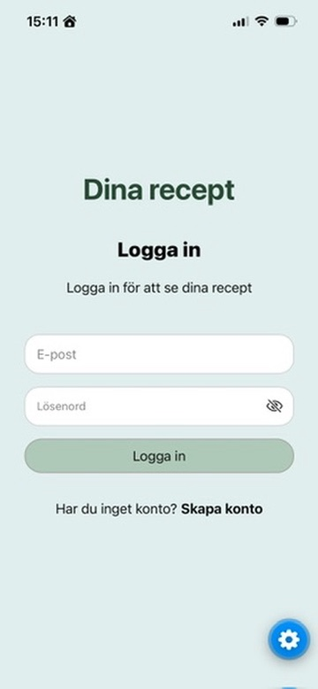
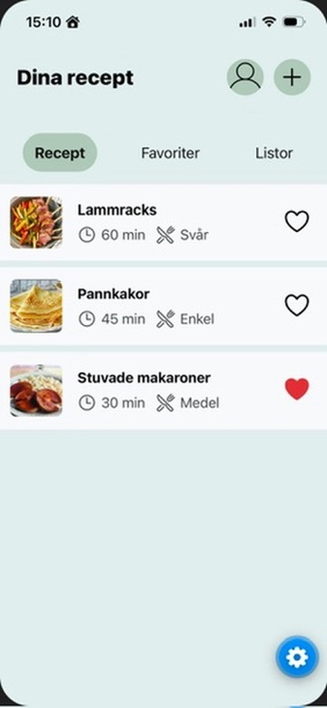

# Dina recept

  
  

## Om appen

Dina recept är en minimalistisk receptapp för personer som vill samla recept från olika källor på ett och samma ställe. Appen gör det enklare att hitta recept, samla personliga favoriter och hålla ordning på sin egen receptsamling – utan reklam eller onödiga funktioner.

Appen har en egen backend och databas där användarkonton och recept sparas separat för varje användare.

## Funktioner

- Registrering och inloggning
- Skapa, visa, redigera och ta bort recept
- Visa recept med ingredienser och instruktioner
- Spara recept kopplade till det egna användarkontot
- Hantera personliga favoriter

## Vidare utveckling

Funktioner som kan läggas till i framtiden:

- Sökfunktion
- Filtrera recept efter exempelvis tillagningstid och kostpreferenser
- Planera måltider
- Importera recept via URL
- Importera recept via skanning
- Logga när ett recept har lagats och lägga till egna anteckningar och betyg

## Skärmar och data

- **Registrering och inloggning:** Skapa konto och logga in med e-post och lösenord.
- **Startsida:** Lista med användarens sparade recept.
- **Detaljsida för recept:** Namn, kategori, tillagningstid, antal portioner, ingredienser och instruktioner.
- **Lägg till/redigera recept:** Formulär för att skapa och ändra recept.
- **Profil:** Användarens kontoinformation och inställningar.

Varje recept kopplas till användaren som har skapat det. Användarkonton och recept sparas i MySQL-databasen och finns kvar även efter att appen har stängts.

## Teknik

- **React Native** – mobilapp
- **Expo och Expo Router** – utveckling och navigation
- **Node.js och Express** – backend och API
- **MySQL** – databas
- **JWT** – autentisering
- **bcrypt** – säker lösenordshashning
- **Docker** – paketering och driftsättning
- **AWS EC2** – server för backend och databas
- **Nginx** – reverse proxy
- **DuckDNS och Let's Encrypt** – domän och HTTPS

## Deployment

Backend och databas är driftsatta på en AWS EC2-server med Docker Compose.

API:  
https://dinarecept.duckdns.org/api

Servern är konfigurerad för att starta om applikationens containrar automatiskt vid omstart. HTTPS används för säker kommunikation mellan appen och backend.

## Lokal utveckling

För att köra projektet lokalt behöver du installera Node.js, npm och Expo.

1. Klona repot.
2. Installera beroenden i appens och backendens mappar.
3. Konfigurera miljövariabler för backend och databas.
4. Starta backend och databas.
5. Starta Expo-appen.

Se till att använda en lokal API-adress i appens konfiguration när du utvecklar lokalt.
